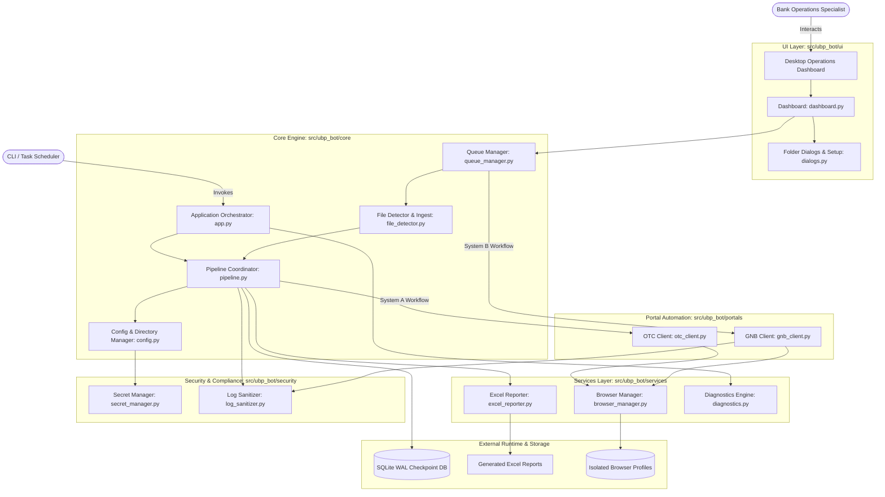

# Architecture Specification — UBP Bot Phase 1 Enterprise Implementation

## 1. Executive Architecture Summary

**UBP Bot** is an enterprise transaction processing and rejection extraction automation system designed for banking operations. The Phase 1 implementation establishes automated batch extraction and processing across two independent core banking and utility portals:
1. **System A: OTC BPS Portal** (Over-The-Counter Bill Payment System) — Operated via assisted manual operator authentication (preserving operator-controlled credential and OTP entry), automated page navigation, transaction query execution, multi-page data extraction, and strict business-rule classification.
2. **System B: GNB Core Banking Portal** (General Banking Network) — Operated via dedicated, isolated headless/automated browser sessions for core transaction query and rejection extraction.

The architecture strictly enforces total subsystem isolation, zero-trust credential handling, dynamic directory management, atomic data serialization, and comprehensive log sanitization.

---

## 2. Component Architecture & System Diagram

---

## 3. Subsystem Decomposition

### 3.1. Core Module (`src/ubp_bot/core/`)
- **`config.py`**: Resolves portable application paths, manages dynamic directory configuration, performs atomic read/write permission verification, scrubs secrets prior to serialization, and loads environment variables.
- **`pipeline.py`**: Coordinates batch automation lifecycle, computes unique deterministic batch IDs (`sha256(path + mtime)`), executes row-by-row queries, records SQLite checkpoints, and initiates final reporting.
- **`file_detector.py`**: Monitors incoming spreadsheets (`.xlsx`, `.xls`, `.csv`), performs file-write stability verification (eliminating partial write race conditions), routes input files based on naming convention (`OTC` vs `GNB`), and safely moves files across lifecycle stages (`input/` -> `processing/` -> `completed/` or `failed/`).
- **`queue_manager.py`**: Manages asynchronous multi-threaded directory monitoring and execution queues, ensuring sequential and safe batch handling.

### 3.2. Portals Module (`src/ubp_bot/portals/`)
- **`otc_client.py`**: Encapsulates all OTC BPS portal interactions: manual authentication detection, non-destructive navigation to Check Bill Status, bank dropdown matching, consumer search execution, table pagination, and transaction classification.
  - **CRITICAL BUSINESS RULE**: OTC response codes `95` and `98` are strictly excluded from qualifying rejections.
- **`gnb_client.py`**: Executes GNB extraction in a dedicated worker thread with an isolated Playwright instance, eliminating greenlet context-switching errors and ensuring independent browser state.

### 3.3. Services Module (`src/ubp_bot/services/`)
- **`browser_manager.py`**: Centralizes Playwright browser session lifecycle, persistent profile directory allocation (`browser_profile` vs `browser_profile_gnb`), Chromium runtime verification, and CDP remote debugging.
- **`excel_reporter.py`**: Generates styled, banking-grade Excel outputs (`OTC_Rejected_Transactions.xlsx` and `GNB_Rejected_Transactions.xlsx`). Protects against CSV/formula injection (`=`, `+`, `-`, `@`, `\t`, `\r`), and uses atomic file replacement with previous-run backups.
- **`diagnostics.py`**: Performs complete pre-flight validation of Python environment, dependency presence, Playwright browser binaries, network connectivity, and directory permissions.

### 3.4. Security Module (`src/ubp_bot/security/`)
- **`secret_manager.py`**: Enforces strict separation of configuration and secrets. Reads credentials from OS environment variables or local `.env` files without writing them to disk.
- **`log_sanitizer.py`**: Real-time masking of passwords, API keys, tokens, session IDs, Pakistani CNICs, bank account numbers, and credit card numbers across all file and UI logs.

### 3.5. UI Module (`src/ubp_bot/ui/`)
- **`dashboard.py`**: High-contrast enterprise light dashboard designed with an 8px grid system. Features independent OTC and GNB controls, dynamic directory pickers, real-time counters, progress bar, and split consoles.
- **`dialogs.py`**: Modal directory picker dialogs with read/write permission validation and cancellation protection (preserving valid paths if canceled).

---

## 4. Cross-System Isolation Model

To satisfy enterprise banking requirements, **System A (OTC)** and **System B (GNB)** operate under complete architectural isolation:
1. **Thread Separation**: OTC runs in the main automation worker thread; GNB runs in a dedicated thread with its own event loop and locks.
2. **Browser Instance Isolation**: Each system initializes its own Playwright instance. OTC and GNB never share a browser context, page, or socket.
3. **Profile Isolation**: OTC browser data is saved to `checkpoints/browser_profile`, while GNB uses `checkpoints/browser_profile_gnb`. Cookies, storage, and cache never intersect.
4. **Data & Report Isolation**: OTC writes to `OTC_Rejected_Transactions.xlsx` while GNB writes to `GNB_Rejected_Transactions.xlsx`. An error or crash in GNB never aborts or corrupts OTC operations, and vice versa.

---

## 5. Idempotency & Fault-Tolerance Strategy

- **File Deduplication**: Incoming spreadsheets are hashed using SHA-256. If a file's hash already exists in `file_history` with status `COMPLETED`, it is immediately archived without duplicate extraction.
- **Row-Level Checkpointing**: Each input row result is committed to SQLite with WAL mode (`PRAGMA journal_mode = WAL`). Interrupted runs automatically resume from the last uncompleted row.
- **Atomic File Operations**: Reports and configuration files are written to `.tmp_` files and swapped atomically into place, with automated backup copies (`*_prev.xlsx`) retained for audit compliance.
