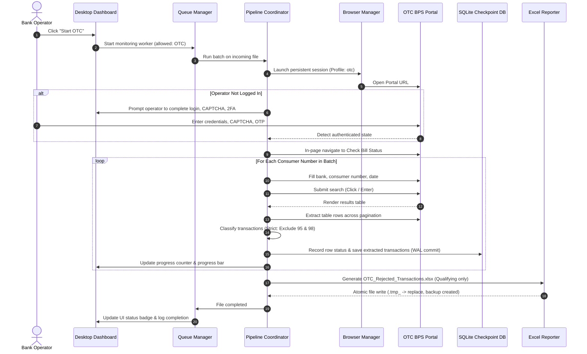
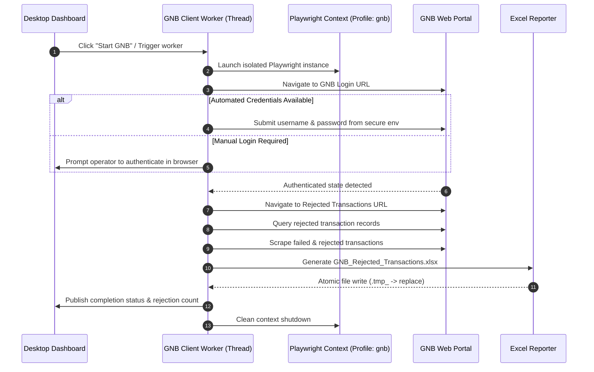
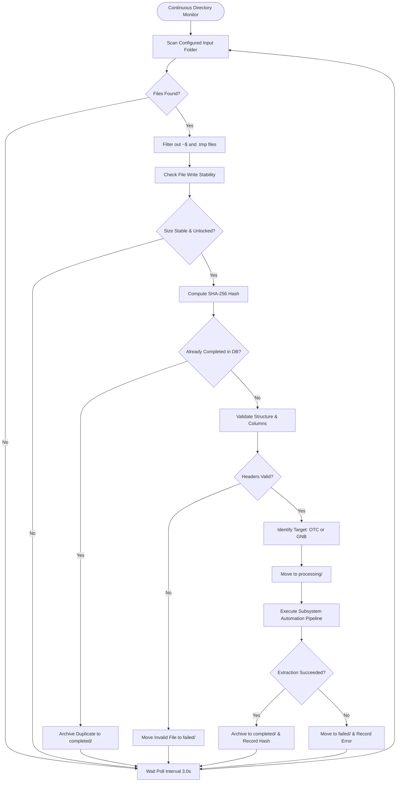
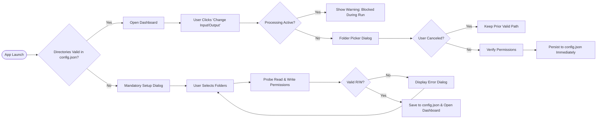

# Workflow Reference — UBP Bot Phase 1

This document describes the operational workflows for the UBP Bot system.

---

## 1. System A: OTC BPS Portal Workflow

The OTC workflow handles bill payment verification through the BPS web portal:

### Key Business Rule Enforcement
- **Excluded Codes**: If `response_code == '95'` or `response_code == '98'`, the transaction is labeled `Excluded Rejection` with `is_qualifying_rejection = False`. It is **omitted** from `OTC_Rejected_Transactions.xlsx`.
- **Approved Transactions**: Codes `00` or statuses containing `APPROVED`/`SUCCESSFUL` are labeled `Approved` with `is_qualifying_rejection = False`.
- **Qualifying Rejections**: Status `REJECTED`, `DECLINED`, `FAILED`, etc. with non-approved, non-excluded codes (e.g. `51`, `05`) are labeled `Rejected` with `is_qualifying_rejection = True` and exported to the final Excel report.

---

## 2. System B: GNB Core Banking Portal Workflow

The GNB workflow extracts rejected transactions from the core banking network:

---

## 3. Continuous Directory Monitoring Workflow

---

## 4. Dynamic Directory Configuration Workflow

---

## 5. Checkpoint, Recovery, and Resumption Workflow

1. **Batch Identification**: A unique batch identifier is generated based on file path and last modification timestamp (`batch_<sha256[:12]>`).
2. **Batch Registration**: Inserted into `batches` table in SQLite (`processing_checkpoint.db`).
3. **Processed Rows Check**: Query `SELECT row_number FROM processed_rows WHERE batch_id = ?`.
4. **Row Skip**: If row index exists in completed row list, the bot skips to the next unprocessed row without repeated portal queries.
5. **Session Expiry Recovery**: If session expires during processing, automation halts, notifies operator, recovers authentication, navigates back to Check Bill Status, and resumes from current row.
6. **Graceful Stop**: If operator clicks "Stop OTC" or "Stop GNB", current row query finishes, row result is committed to DB, and batch is marked `STOPPED`. Checkpoint is preserved.
